# Smart Timetable Assistant

An intelligent academic schedule-management and optimization platform built with Streamlit, Supabase, and Google Calendar.

[](https://smart-timetable-assistant-phystar.streamlit.app/)
[](https://github.com/Swadhin154/Smart-Timetable-Assistant)
[](https://www.python.org/)
[](https://supabase.com/)
[](https://developers.google.com/calendar)

---

## Table of Contents

1. [Project Overview](#project-overview)
2. [Key Features](#key-features)
3. [System Architecture & Technology Stack](#system-architecture--technology-stack)
4. [Core Scheduling & Optimization Logic](#core-scheduling--optimization-logic)
5. [Repository Structure](#repository-structure)
6. [Local Installation & Setup](#local-installation--setup)
7. [Configuration & Environment Secrets](#configuration--environment-secrets)
8. [Supabase Database Setup](#supabase-database-setup)
9. [Google Calendar API Setup](#google-calendar-api-setup)
10. [Application Walkthrough](#application-walkthrough)
11. [Testing & Quality Assurance](#testing--quality-assurance)
12. [Deployment Guide](#deployment-guide)
13. [Security & Privacy Considerations](#security--privacy-considerations)
14. [Useful Links](#useful-links)

---

## Project Overview

**Smart Timetable Assistant** is a comprehensive academic productivity platform designed to help university students and educators manage courses, timetable conflicts, exam preparation roadmaps, and assignment deadlines in one unified application.

University students routinely manage overlapping lectures, lab sessions, varying semester timetables, assignment submission deadlines, and preparations for mid-term and end-term examinations. Traditional timetables are often distributed as static documents that cannot flag overlaps or adapt to changing schedules.

Smart Timetable Assistant solves these challenges through:
- **Conflict Detection:** Automated detection of overlapping class periods on the same day.
- **Dynamic Free-Time Harvesting:** Identification of available study gaps within daily working hours.
- **Automated Exam Study Planning:** Algorithmic distribution of revision sessions based on course difficulty, current preparedness, and timetable availability.
- **Weighted Deadline Prioritization:** Multi-criteria scoring balancing due date proximity, task priority, and estimated workload.
- **Two-Way Google Calendar Sync:** Secure Google Calendar OAuth 2.0 web flow to import existing calendar events into the timetable and create events directly in cloud calendars.
- **Consolidated Reporting:** One-click export of complete academic data into multi-sheet Excel workbooks (`.xlsx`) and formatted PDF summaries (`.pdf`).

### Live Application and Repository
- **Live Deployment:** [https://smart-timetable-assistant-phystar.streamlit.app/](https://smart-timetable-assistant-phystar.streamlit.app/)
- **Source Repository:** [https://github.com/Swadhin154/Smart-Timetable-Assistant](https://github.com/Swadhin154/Smart-Timetable-Assistant)

---

## Key Features

- **User Authentication & Multi-Tenancy:**
  - Secure email-and-password sign-up and sign-in powered by Supabase Auth.
  - Server-side session state management with authenticated API access for database queries.

- **Centralized Academic Dashboard (`pages/1_Home.py`):**
  - High-level metric cards: Today's Classes, Upcoming Exams, Pending Deadlines, and Today's Study Sessions.
  - Chronological daily agenda highlighting classes and study sessions.
  - Multi-view timetable display: Week View, Day View, and Month View.
  - Quick sidebar cards: Exam countdown timer, prioritized pending tasks, and revision tips.

- **Timetable Management & Conflict Resolution (`pages/2_Classes.py`):**
  - **Multiple Input Modes:** Manual class entry with duplicate detection, CSV file upload with validation and preview, and direct import from Google Calendar.
  - **Real-Time Clash Detection:** Identifies and displays overlapping course intervals on the same day.
  - **Timetable Filtering:** View by semester (Semesters 1 through 8) or day of the week, with one-click CSV export.
  - **Timetable Editing:** Modify entries inline or delete individual or batch classes.

- **Intelligent Free-Time & Study Tools (`pages/2_Classes.py`):**
  - **Free-Time Slot Finder:** Scans daily schedules within configurable search windows (default 06:00 AM to 07:00 PM) for gaps meeting minimum duration thresholds (5 to 60 minutes).
  - **Study Slot Recommender:** Identifies and ranks the top continuous uninterrupted free periods for focused revision.
  - **"Ask Your Timetable" NLP Engine:** Natural language query parser (`natural_language.py`) that extracts user intent (clashes, free time, study slots) and target weekdays.

- **Exam Management (`pages/3_Exams.py`):**
  - Exam scheduling linked to registered courses stored in Supabase.
  - Captures exam title, course association, exam date, exam type (Mid-Semester, End-Semester, Internal, Practical, Other), start/end times, location, and notes.
  - Tabular exam schedule with search, inline editing, deletion, and CSV export.

- **Automated Exam Study Planner (`pages/4_Study_Plan.py`):**
  - Generates multi-day preparation plans for any scheduled upcoming exam.
  - **Two Estimation Modes:** Manual target hours input, or automated calculation based on course difficulty (1–5) and preparedness (1–5).
  - **Constrained Session Allocation:** Allocates study blocks into timetable free slots (minimum 30 minutes, maximum 120 minutes per session, maximum 180 minutes per day).
  - **Session Tracking:** Persists generated sessions to Supabase with status management (`Planned`, `Completed`, `Skipped`).

- **Multi-Criteria Deadline Prioritization (`pages/5_Deadlines.py`):**
  - Tracks assignment and exam deadlines with title, due date, estimated preparation hours, priority level (`Low`, `Medium`, `High`), and reminder settings.
  - **Priority Scoring Engine:** Evaluates tasks on a 0–100 scale using weighted components (40% urgency, 35% priority, 25% workload) and groups them into actionable recommendation tiers.
  - Real-time status badges (`Due today`, `Due soon`, `Upcoming`, `Overdue`) and CSV export.

- **Academic Calendar & Holidays (`pages/6_Holidays.py`):**
  - Reference calendar of Indian Gazetted National Holidays (2026 reference data based on India Post).
  - Personal academic milestone tracker for institutional events (Semester Start/End, Internal Exams, Practicals, Project Milestones, College Fests).
  - Add, edit, delete, and download milestones as CSV.

- **Consolidated Academic Reporting (`pages/7_Reports.py`):**
  - **Excel Report (`.xlsx`):** Generated via `openpyxl`, organizing Timetable, Courses, Exams, Study Sessions, Deadlines, and Academic Events into individual structured tabs.
  - **PDF Report (`.pdf`):** Formatted landscape A4 academic summary compiled programmatically with `ReportLab`.

- **Google Calendar Cloud Integration (`google_calendar_web.py`):**
  - OAuth 2.0 Web Flow with state verification and server-side token encryption.
  - Create Google Calendar events directly from the application in the `Asia/Kolkata` timezone.
  - Import timed calendar events into the timetable with deduplication.

---

## System Architecture & Technology Stack

### Architecture Overview

```mermaid
flowchart TD
    subgraph Client["Presentation Layer (Streamlit Multi-Page)"]
        APP["app.py (Entry & Auth Gate)"]
        P1["1_Home.py (ui_pages/home.py)"]
        P2["2_Classes.py"]
        P3["3_Exams.py"]
        P4["4_Study_Plan.py"]
        P5["5_Deadlines.py"]
        P6["6_Holidays.py"]
        P7["7_Reports.py"]
    end

    subgraph Logic["Analytical & Business Logic Modules"]
        SCHED["scheduling_logic.py (Clash Detection)"]
        FREE["free_time_logic.py (Free Slot Harvesting)"]
        REC["study_recommendations.py (Ranked Study Windows)"]
        NLP["natural_language.py (Query Intent Parser)"]
        DPLAN["deadline_planner.py & deadline_logic.py"]
        EXPLAN["exam_study_planner.py (Study Allocation Engine)"]
        REP["academic_report_generator.py (Excel & PDF Engines)"]
        HOL["academic_calendar.py (Holiday Reference Data)"]
    end

    subgraph External["External Cloud Services & Persistence"]
        SUPA[("Supabase (PostgreSQL & Auth)")]
        GCAL["Google Calendar API v3 (OAuth 2.0 Web Flow)"]
    end

    APP --> P1 & P2 & P3 & P4 & P5 & P6 & P7
    P2 --> SCHED & FREE & REC & NLP & GCAL
    P4 --> EXPLAN & FREE
    P5 --> DPLAN
    P6 --> HOL
    P7 --> REP

    APP --> SUPA
    P1 & P2 & P3 & P4 & P5 & P6 & P7 --> SUPA
```



### Technology Matrix

| Layer / Component | Technology | Purpose |
| :--- | :--- | :--- |
| **Frontend Framework** | Streamlit 1.64.0 | Multi-page web interface, reactive session state, form handling |
| **Runtime & Language** | Python 3.11+ | Application runtime and algorithmic execution |
| **Database & Auth** | Supabase (PostgreSQL) | Managed user authentication and persistent cloud data storage |
| **Database Client** | supabase-py 2.24.0 | Python SDK connecting the app to Supabase PostgREST endpoints |
| **Calendar API** | Google Calendar API v3 | Google OAuth 2.0 Web Flow, event creation, and timetable import |
| **OAuth Security** | Cryptography (Fernet) & itsdangerous | Encrypting stored tokens and signing OAuth state tokens |
| **Data Processing** | Pandas 3.0.6 & NumPy | Data manipulation, tabular display, and CSV export/import |
| **Spreadsheet Engine** | OpenPyXL | Multi-tab Excel (`.xlsx`) academic report generation |
| **PDF Generation** | ReportLab | Publication-grade landscape A4 academic summary reports |
| **Testing** | Python `unittest` | Automated unit testing for core scheduling and business logic |

---

## Core Scheduling & Optimization Logic

### 1. Timetable Conflict Detection (`scheduling_logic.py`)
Two scheduled classes $C_1$ and $C_2$ on the same weekday conflict if and only if their active intervals overlap:
- A conflict exists when: `(Start1 < End2) and (Start2 < End1)`
- Back-to-back classes where `End1 == Start2` or `End2 == Start1` are recognized as non-conflicting adjacent periods.
- Classes with zero or negative durations (`Start >= End`) are rejected during input validation.

### 2. Free-Time Slot Harvesting (`free_time_logic.py`)
Within a defined daily active window (default `06:00` to `19:00`):
1. Classes on the selected day are filtered and clipped to the window boundaries.
2. Occupied periods are sorted by start time, and overlapping or contiguous intervals are merged.
3. Complementary gaps between merged busy periods are calculated.
4. Gaps meeting or exceeding the user's minimum duration threshold (e.g., 30 minutes) are returned as available free slots.

### 3. Exam Study Planning Engine (`exam_study_planner.py`)
- **Hours Estimation:** When automatic estimation is selected, recommended preparation hours are calculated based on course difficulty (scale 1–5) and student preparedness (scale 1–5):
  $$\text{Hours} = 4 + (2 \times \text{Difficulty}) + (2 \times (6 - \text{Preparedness}))$$
  - Minimum estimate ($D=1, P=5$): $8\text{ hours}$
  - Maximum estimate ($D=5, P=1$): $24\text{ hours}$
- **Session Allocation:**
  - Iterates day-by-day from the planning date up to the day before the examination.
  - Queries available timetable gaps using `find_free_slots`.
  - Applies allocation limits: session length between 30 and 120 minutes, capped at a maximum of 180 minutes per day.
  - Returns allocated sessions and reports any remaining unallocated time if available slots are insufficient.

### 4. Multi-Criteria Deadline Prioritization (`deadline_planner.py`)
Deadlines are ranked using a composite score (0–100 scale) based on three factors:
$$\text{Score} = (0.40 \times \text{Urgency}) + (0.35 \times \text{Priority}) + (0.25 \times \text{Workload})$$

- **Urgency (40% weight):**
  - If days remaining $\le 0$: score is $100$.
  - If days remaining $> 0$: score is $\max(0, 100 - (5 \times \text{days remaining}))$.
- **Priority (35% weight):**
  - High priority: $100$
  - Medium priority: $60$
  - Low priority: $30$
- **Workload (25% weight):**
  - Scaled from estimated preparation hours: $\min(\text{hours} \times 10, 100)$.
- **Recommendation Tiers:**
  - $\text{Score} \ge 75 \implies \textbf{High}$ (immediate action recommended)
  - $45 \le \text{Score} < 75 \implies \textbf{Medium}$
  - $\text{Score} < 45 \implies \textbf{Low}$

---

## Repository Structure

```text
Smart-Timetable-Assistant/
├── .devcontainer/
│   └── devcontainer.json              # Development container configuration
├── pages/                             # Streamlit multi-page routes
│   ├── 1_Home.py                      # Home dashboard view
│   ├── 2_Classes.py                   # Timetable, clash detection, Google Calendar sync
│   ├── 3_Exams.py                     # Exam scheduling & management
│   ├── 4_Study_Plan.py                # Automated exam study plan generator
│   ├── 5_Deadlines.py                 # Assignment tracker with weighted priority scoring
│   ├── 6_Holidays.py                  # Indian national holiday reference & personal events
│   └── 7_Reports.py                   # Consolidated PDF & Excel report generator
├── ui_pages/                          # Decoupled UI presentation modules
│   └── home.py                        # Layout and dashboard components for the Home view
├── academic_calendar.py               # 2026 Indian National Holiday reference data
├── academic_event_storage.py          # Supabase CRUD operations for personal academic events
├── academic_report_generator.py       # Excel (openpyxl) and PDF (ReportLab) report engine
├── app.py                             # Main application entry point & authentication gate
├── app_auth.py                        # Supabase authentication helpers and session management
├── course_storage.py                  # Supabase CRUD operations for courses
├── deadline_logic.py                  # Deadline field validation & temporal status calculation
├── deadline_planner.py                # Weighted multi-criteria deadline ranking algorithm
├── deadline_storage.py                # Supabase CRUD operations for assignment deadlines
├── exam_storage.py                    # Supabase CRUD operations for examinations
├── exam_study_planner.py              # Algorithmic study plan generator & hour estimator
├── free_time_logic.py                 # Free slot harvesting within daily time windows
├── google_calendar.py                 # Standalone/desktop Google Calendar OAuth client
├── google_calendar_web.py             # Google OAuth 2.0 Web flow, encryption & calendar client
├── natural_language.py                # Regex-based natural language timetable query parser
├── requirements.txt                   # Project Python dependencies
├── scheduling_logic.py                # Temporal overlap & timetable clash detection engine
├── study_recommendations.py           # Ranking algorithm for continuous study windows
├── study_session_storage.py           # Supabase CRUD operations for generated study sessions
├── test_deadline_logic.py             # Unit tests for deadline validation & statuses
├── test_exam_study_planner.py         # Test script verifying study plan allocation rules
├── test_free_time_logic.py            # Unit tests for free-slot harvesting engine
├── test_natural_language.py           # Unit tests for timetable query intent extraction
├── test_scheduling_logic.py           # Unit tests for timetable clash detection
├── test_study_recommendations.py      # Unit tests for ranked study slot recommendations
├── .gitignore                         # Git exclusion rules for credentials, caches & venvs
├── privacy-policy.md                  # Application privacy policy & Google data usage terms
└── README.md                          # Project documentation and user guide
```

---

## Local Installation & Setup

### 1. Prerequisites
- **Python 3.11+** installed on your system.
- **Git** installed.

### 2. Clone the Repository
```bash
git clone https://github.com/Swadhin154/Smart-Timetable-Assistant.git
cd Smart-Timetable-Assistant
```

### 3. Create and Activate a Virtual Environment

**On Windows (PowerShell):**
```powershell
python -m venv .venv
Set-ExecutionPolicy -Scope Process -ExecutionPolicy Bypass
.\.venv\Scripts\Activate.ps1
```

**On Linux / macOS:**
```bash
python3 -m venv .venv
source .venv/bin/activate
```

### 4. Install Dependencies
```bash
pip install --upgrade pip
pip install -r requirements.txt
```

### 5. Configure Local Secrets
Create a `.streamlit/secrets.toml` file in the project root:

**On Windows (PowerShell):**
```powershell
New-Item -ItemType Directory -Force -Path .streamlit
New-Item -ItemType File -Force -Path .streamlit\secrets.toml
```

**On Linux / macOS:**
```bash
mkdir -p .streamlit
touch .streamlit/secrets.toml
```

Populate `.streamlit/secrets.toml` with the required keys as described in the [Configuration & Environment Secrets](#configuration--environment-secrets) section.

### 6. Run the Application
```bash
streamlit run app.py
```
Open your browser at `http://localhost:8501`.

---

## Configuration & Environment Secrets

The application requires specific configuration keys to connect to Supabase and Google Calendar. These keys must be stored in `.streamlit/secrets.toml` for local development, or entered under **Settings > Secrets** in Streamlit Community Cloud.

### Secrets Template (`.streamlit/secrets.toml`)

```toml
# Supabase Authentication & Database Configuration
SUPABASE_URL = "https://your-project-id.supabase.co"
SUPABASE_SECRET_KEY = "your-supabase-key"

# Google Calendar OAuth 2.0 Web Client Credentials
GOOGLE_WEB_CLIENT_ID = "your-client-id.apps.googleusercontent.com"
GOOGLE_WEB_CLIENT_SECRET = "your-client-secret"

# Cryptographic Token Encryption Key
# 32-byte URL-safe base64-encoded string for Fernet symmetric encryption
TOKEN_ENCRYPTION_KEY = "your-fernet-encryption-key-here="
```

> [!TIP]
> **Generating `TOKEN_ENCRYPTION_KEY`:**
> Run the following Python command in your terminal to generate a valid key:
> ```bash
> python -c "from cryptography.fernet import Fernet; print(Fernet.generate_key().decode())"
> ```

---

## Supabase Database Setup

The application persistence layer relies on Supabase for authentication and PostgreSQL data storage.

### 1. Enable Email Authentication
1. In the Supabase project dashboard, navigate to **Authentication > Providers > Email**.
2. Enable email sign-up and sign-in.
3. In **Authentication > URL Configuration**, add your application redirect URLs:
   - Local: `http://localhost:8501/`
   - Production: `https://smart-timetable-assistant-phystar.streamlit.app/`

### 2. Application Tables Reference
The storage modules expect the following tables in your Supabase database:

| Table Name | Primary Purpose | Fields Utilized by Code |
| :--- | :--- | :--- |
| `courses` | Registered courses | `id`, `user_id`, `course_name`, `course_code`, `semester`, `credits`, `teacher` |
| `exams` | Scheduled examinations | `id`, `user_id`, `course_id`, `exam_title`, `exam_date`, `start_time`, `end_time`, `exam_type`, `location`, `notes` |
| `study_sessions` | Generated study sessions | `id`, `user_id`, `exam_id`, `course_id`, `session_date`, `start_time`, `end_time`, `duration_minutes`, `status` |
| `deadlines` | Assignments & deadlines | `id`, `user_id`, `title`, `due_date`, `estimated_hours`, `priority`, `reminder_at`, `reminder_enabled` |
| `academic_events` | Personal academic milestones | `id`, `user_id`, `event_title`, `event_date`, `event_type`, `description` |
| `google_calendar_tokens` | Encrypted Google OAuth tokens | `user_id`, `encrypted_token`, `updated_at` |
| `google_oauth_pending` | Temporary OAuth handshakes | `nonce`, `user_id`, `encrypted_access_token`, `encrypted_refresh_token`, `encrypted_verifier`, `expires_at` |

---

## Google Calendar API Setup

The application integrates with Google Calendar via an OAuth 2.0 Web Application client flow.

### 1. Google Cloud Console Configuration
1. Go to the [Google Cloud Console](https://console.cloud.google.com/).
2. Create a new project (e.g., `Smart-Timetable-Assistant`).
3. In **APIs & Services > Library**, search for and enable the **Google Calendar API**.
4. Configure the **OAuth Consent Screen**:
   - User Type: **External**
   - Application Name: `Smart Timetable Assistant`
   - Scopes: Add `https://www.googleapis.com/auth/calendar.events` (View and edit events on your calendars)
   - Add your Google account under **Test users** while in testing mode.
5. In **APIs & Services > Credentials**, click **Create Credentials > OAuth client ID**:
   - Application Type: **Web application**
   - Name: `Smart Timetable Assistant Web Client`
   - **Authorized redirect URIs:**
     - Production: `https://smart-timetable-assistant-phystar.streamlit.app/`
     - Local development: `http://localhost:8501/`
6. Copy the **Client ID** and **Client Secret** into your `.streamlit/secrets.toml` under `GOOGLE_WEB_CLIENT_ID` and `GOOGLE_WEB_CLIENT_SECRET`.

### 2. OAuth Authentication Flow
- **Initiation (`start_google_oauth`):** When the user clicks "Continue to Google", the system creates a PKCE code verifier and unique nonce, generates a signed state token with `URLSafeTimedSerializer`, and stores encrypted session tokens temporarily in `google_oauth_pending`.
- **Callback Processing (`handle_google_oauth_callback`):** When Google redirects back to the application with `code` and `state`, the app verifies the signed state, restores the session, exchanges the authorization code for credentials, encrypts the credentials payload with Fernet, and saves it in `google_calendar_tokens`.

---

## Application Walkthrough

### 1. Authentication Gate (`app.py`)
- Unauthenticated visitors see the sign-in / sign-up interface while the navigation sidebar remains hidden.
- Sign In verifies credentials with Supabase Auth and stores session tokens.
- Sign Up creates new accounts with email verification.
- Once authenticated, the sidebar navigation and landing dashboard become accessible.

### 2. Home Dashboard (`pages/1_Home.py`)
- **Metric Cards:** Displays counters for today's classes, upcoming exams, pending deadlines, and today's scheduled study sessions.
- **Today's Schedule:** Chronological timeline showing classes and planned revision sessions for the current day.
- **Multi-View Timetable:** Switch between Week View, Day View, and Month View.
- **Sidebar Widgets:** Countdown to the next examination, top urgent assignments, and dynamic study tips.

### 3. Classes & Timetable (`pages/2_Classes.py`)
- **Add Timetable:** Add entries manually, upload a CSV file with validation and preview, or import events directly from Google Calendar.
- **Clash Detection:** Highlights conflicting time intervals on the same day with subject details.
- **Filter & Export:** Filter classes by semester or weekday, with options to download as CSV, edit entries inline, or delete classes.
- **Free Time & Recommendations:** Find open slots in your schedule or view the 3 longest continuous periods recommended for study.
- **Ask Your Timetable:** Query timetable information using natural language prompts.
- **Google Calendar Tools:** Check connection status, create new calendar events, or import existing calendar entries into your timetable.

### 4. Exam Management (`pages/3_Exams.py`)
- Add upcoming examinations linked to registered courses.
- Record exam title, course, date, exam type (Mid-Semester, End-Semester, Internal, Practical, Other), start/end times, location, and notes.
- View, edit, delete, and export exams to CSV.

### 5. Exam Study Planner (`pages/4_Study_Plan.py`)
- Select an upcoming exam to generate a study roadmap.
- Choose between manual hours entry or difficulty/preparedness estimation.
- Generates study sessions fitted into timetable free slots (30–120 mins per session, max 180 mins per day).
- Track session statuses (`Planned`, `Completed`, `Skipped`) or delete sessions.

### 6. Deadlines Tracker (`pages/5_Deadlines.py`)
- Track assignments and project due dates with estimated workload and priority.
- View deadlines prioritized by the multi-criteria algorithm (urgency, priority, workload).
- Displays priority scores, progress bars, recommendation tiers, remaining days, and export options.

### 7. Academic Calendar & Holidays (`pages/6_Holidays.py`)
- Reference list of Indian Gazetted National Holidays for 2026 with toggles for Upcoming vs. All Holidays.
- Manage personal institutional milestones (Semester Start/End, Internal Exams, Practicals, Project Milestones, College Fests).
- Supports adding, editing, deleting, and CSV export of academic events.

### 8. Consolidated Academic Reports (`pages/7_Reports.py`)
- **Excel Report (`.xlsx`):** Multi-sheet workbook compiled via `openpyxl` consolidating Timetable, Courses, Exams, Study Sessions, Deadlines, and Academic Events.
- **PDF Report (`.pdf`):** Styled landscape A4 summary document generated with ReportLab.

---

## Testing & Quality Assurance

The project includes unit test suites validating core scheduling logic, free-time harvesting, natural language parsing, study recommendations, deadline prioritization, and exam study planning.

### Test Suites Overview

| Test Module | Target Module | Verified Functionality |
| :--- | :--- | :--- |
| `test_scheduling_logic.py` | `scheduling_logic.py` | Detects overlapping class periods; ignores adjacent slots and distinct weekdays |
| `test_free_time_logic.py` | `free_time_logic.py` | Computes gaps between classes; verifies minimum duration thresholds and day bounds |
| `test_study_recommendations.py` | `study_recommendations.py` | Verifies sorting by longest continuous duration and recommendation limit caps |
| `test_natural_language.py` | `natural_language.py` | Validates intent classification for free time, study slots, clashes, and day extraction |
| `test_deadline_logic.py` | `deadline_logic.py` | Validates input bounds; verifies "Due today", "Upcoming", and "Overdue" classifications |
| `test_exam_study_planner.py` | `exam_study_planner.py` | Verifies daily duration constraints, session slicing, and allocation totals against target hours |

### Running the Tests

To run the verified test suite, activate your virtual environment and execute:

```bash
python -m unittest test_scheduling_logic.py test_free_time_logic.py test_study_recommendations.py test_natural_language.py test_deadline_logic.py test_exam_study_planner.py
```

Or run test discovery across the repository:

```bash
python -m unittest discover -s . -p "test_*.py"
```

---

## Deployment Guide

The application can be deployed to **Streamlit Community Cloud** with continuous deployment linked to a GitHub repository.

### Step-by-Step Deployment

1. **Push Changes to GitHub:** Ensure all repository files are pushed to your GitHub repository.
2. **Sign In to Streamlit Community Cloud:** Visit [share.streamlit.io](https://share.streamlit.io/) and sign in with your GitHub account.
3. **Create New App:**
   - **Repository:** Select your repository (e.g., `Swadhin154/Smart-Timetable-Assistant`).
   - **Branch:** `main`
   - **Main file path:** `app.py`
4. **Configure Secrets:**
   - In the Streamlit Cloud app dashboard, open **Settings > Secrets**.
   - Paste your configuration keys:
     ```toml
     SUPABASE_URL = "https://your-project.supabase.co"
     SUPABASE_SECRET_KEY = "your-supabase-key"
     GOOGLE_WEB_CLIENT_ID = "your-client-id.apps.googleusercontent.com"
     GOOGLE_WEB_CLIENT_SECRET = "your-client-secret"
     TOKEN_ENCRYPTION_KEY = "your-fernet-encryption-key="
     ```
5. **Configure Redirect URIs:**
   - In the Google Cloud Console, add your live app URL (e.g., `https://smart-timetable-assistant-phystar.streamlit.app/`) to **Authorized redirect URIs**.
   - In the Supabase Dashboard under **Authentication > URL Configuration**, add your live app URL to **Redirect URLs**.
6. **Deploy:** Click **Deploy**. Streamlit Cloud installs dependencies from `requirements.txt` and starts the application.

---

## Security & Privacy Considerations

- **Token Encryption at Rest:** Google Calendar OAuth refresh and access tokens are encrypted using symmetric Fernet encryption before being persisted in the Supabase database.
- **Signed OAuth State:** The Google OAuth flow uses PKCE code verifiers and signed, time-limited state tokens via `URLSafeTimedSerializer` to verify incoming callbacks.
- **Credential Protection:** Application secrets, API keys, and environment files are excluded from version control via `.gitignore`.
- **Session Isolation:** Authenticated user tokens are scoped to Streamlit session state and passed directly to Supabase client queries.

---

## Useful Links

- **Live Application:** [https://smart-timetable-assistant-phystar.streamlit.app/](https://smart-timetable-assistant-phystar.streamlit.app/)
- **GitHub Repository:** [https://github.com/Swadhin154/Smart-Timetable-Assistant](https://github.com/Swadhin154/Smart-Timetable-Assistant)
- **Privacy Policy:** [privacy-policy.md](privacy-policy.md)
